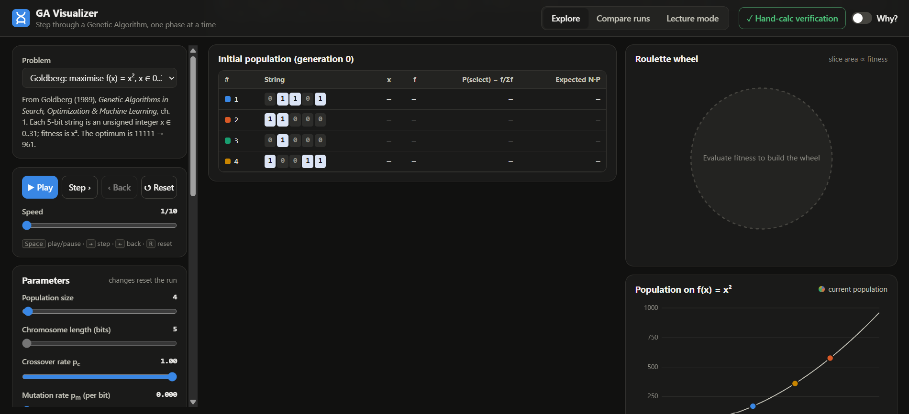
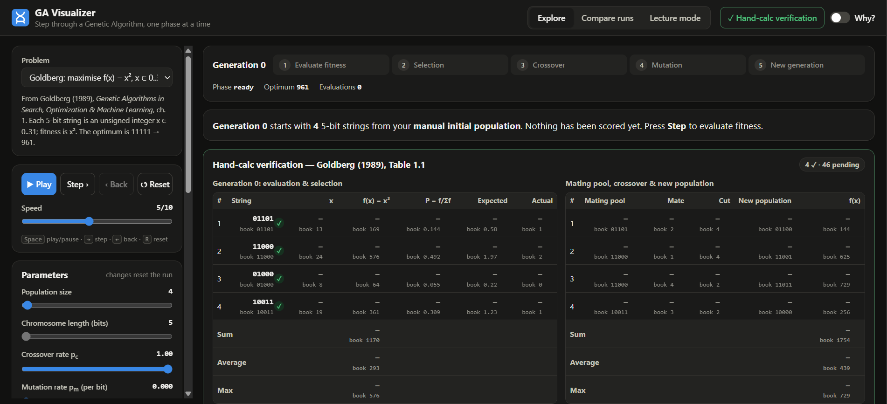
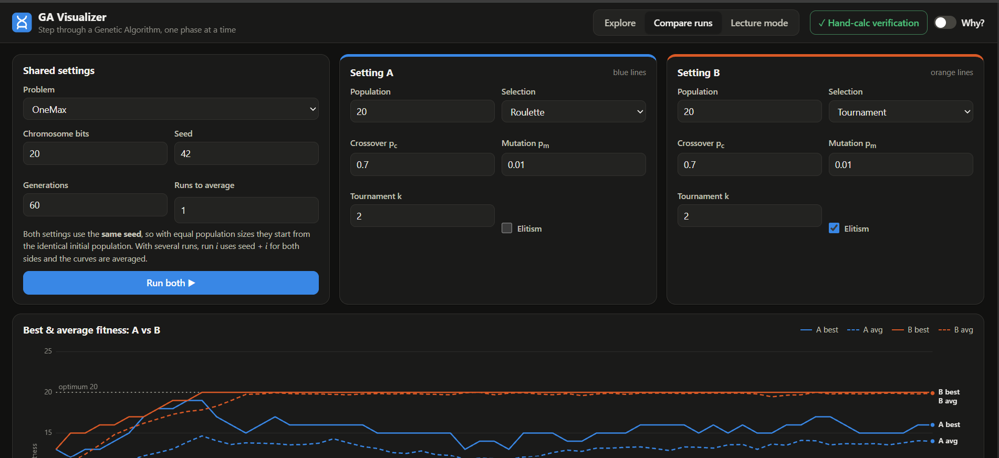

# GA Visualizer: a step-by-step Genetic Algorithm teaching tool

An interactive, single-page tool for learning the **Genetic Algorithm (GA)** by watching every phase happen:
fitness evaluation, roulette-wheel or tournament selection, crossover, mutation and replacement. Each phase shows the
full data table and a plain-language caption.

A **Lecture mode** reproduces the worked examples from the course lecture notes exactly: the same settings, encoding,
table columns and random numbers. A verification panel ticks every value against the notes.

It is **one `index.html` file** with plain HTML, CSS and JavaScript. It has no dependencies, no build step and no network requests.

> **Live demo:** <https://v-ajay-chandra-24.github.io/ga-visualizer/>

### Screenshots

**Explore:** step through each phase with the roulette wheel, data tables, the population plotted on f(x), and the fitness chart.


**Hand-calc verification:** Goldberg's x² example, with each computed value ticked against the textbook.


**Compare runs:** two parameter settings on the same seed, charted side by side.


---

## How to run

- **Locally:** double-click `index.html`, or open it in any modern browser (Chrome, Edge, Firefox, Safari). No server is needed.
- **GitHub Pages:** push the repo, then go to **Settings → Pages → Build and deployment → Deploy from a branch** and pick
  your branch with folder `/ (root)`. The site is served from `index.html`.

## Features

### Problems
| Problem | Encoding | Fitness | Optimum |
|---|---|---|---|
| **Goldberg's textbook example** | 5-bit unsigned integer, x ∈ 0..31 | f(x) = x² | `11111` → 961 |
| **OneMax** | L bits (4–64) | number of 1s | all ones → L |
| **Multi-peak function** | L bits (6–24) mapped linearly to x ∈ [−1, 2] | f(x) = x·sin(10πx) + 2 | x ≈ 1.85, f ≈ 3.85 |

### Parameters
Population size, chromosome length, crossover rate p<sub>c</sub>, mutation rate p<sub>m</sub> (per bit), selection
method (roulette wheel / tournament with size k), elitism on/off, random seed, play speed, and a "stop after generation" limit.

### Controls
**Play / Pause**, **Step**, **Step Back**, **Reset**. Keyboard: `Space` play/pause, `→` step, `←` back, `R` reset.

- Every run uses a **seeded RNG** (mulberry32), so the same seed and settings always give the same run.
- **Step Back** restores a full snapshot, including the RNG state, so stepping forward again replays exactly the same values.

### Step-by-step phases
Each generation is split into five visible phases, each with its own table and caption:

1. **Evaluate fitness**: string, decoded x, f(x), selection probability, expected count, plus sum, average and max rows.
2. **Selection**: an animated roulette wheel spins once per slot and lands on a slice. Tick marks on the rim record every
   landing, and there is a spin log plus an *Actual count* column and a mating-pool table.
   Tournament mode lists every match (contestants → winner).
   Example caption: *"Parent 2 won 2 spins because it owns 49.2% of the wheel."*
3. **Crossover**: each pair is shown with its cut point. Child bits are underlined blue or orange to show which parent they
   came from, and the tail swap is animated. Pairs that don't cross (r ≥ p<sub>c</sub>) are labelled.
4. **Mutation**: flipped bits get a red ring and their positions are listed. The caption compares expected and actual flips.
5. **New generation**: the children replace the parents. Elitism (if on) is marked, and old vs new sum/avg/max are shown.

### Visuals
- Population as rows of colored bit cells. Colour swatches link each row to its wheel slice and its dot on the curve.
- Roulette wheel (canvas) with an easing spin animation and a highlighted winning slice.
- **Fitness vs. generation** chart (best and average, with the optimum line) with hover tooltips.
- For the function problems, individuals are plotted as **dots on the curve**, with the previous generation shown as hollow
  rings. For OneMax there is a histogram of the number of 1s instead.

### Unique features
1. **Hand-calc verification mode** (`✓ Hand-calc verification` button). This loads Goldberg's example with the textbook's
   fixed numbers and shows each computed value next to the textbook value, with a green ✓ or red ✗.
   **Manual overrides** let you enter your own initial population, roulette random numbers, crossover points and
   mutation flips, so you can reproduce any hand calculation.
2. **Compare runs**: run two parameter settings (A vs B) on the **same seed** and chart their best and average curves together.
   You can also average over several consecutive seeds. A summary table shows final best, final average, best ever, how many
   runs reached the optimum, and the mean generation at which they did.
3. **"Why?" toggle**: a deeper, beginner-friendly explanation of the current phase: formulas, the intuition behind
   selection pressure, why mutation matters, elitism, and the schema theorem.

### Lecture mode (matches the course lecture notes)
A third tab that follows the lecture notes (`refs/GA_Lecture_Notes.pdf`, `refs/GA_MultiVariable_Lecture_Notes.pdf`) step by step,
using the notes' conventions:

- **Settings:** N = 4, p<sub>c</sub> = 0.8, p<sub>m</sub> = 0.05, G = 3. Roulette selection picks the **first string with q<sub>i</sub> ≥ r**.
  Crossover pairs are (1, 2) and (3, 4) and cross if r<sub>c</sub> < p<sub>c</sub>. A bit flips if r<sub>m</sub> < p<sub>m</sub>. Every setting stays editable.
- **Encoding:** D = Σ b<sub>i</sub>·2<sup>i</sup> and x = x<sub>min</sub> + (x<sub>max</sub> − x<sub>min</sub>)/(2<sup>L</sup> − 1)·D.
  The panel also shows the resolution Δx, the precision bound Δx/2, the search space 2<sup>L</sup>, E<sub>m</sub> = N·L·p<sub>m</sub>,
  and the best representable grid point. A small decoder shows the place-value working for any string you type.
- **Fitness:** minimise with F = 1/(1 + f); maximise with F = f, or F = f + C when f can be negative (Example 4: C = 31).
- **Presets:** Examples 1–4 (x² − 8x + 20, x² + 2x + 3, 15x − x², −x² + 2x + 50), each with 4-bit and 5-bit strings.
  There is also the two-variable Example 1, (x₁ − 3)² + (x₂ − 5)² + 2, with concatenated 4+4 and 5+5 bit strings.
- **Tables with the notes' columns:** evaluation (#, String, D, x, f, F, p<sub>i</sub>, q<sub>i</sub>, N·p<sub>i</sub>, plus Sum, best string and average f).
  Selection: spin, r, selected #, the reason (q<sub>i</sub> ≥ r > q<sub>i−1</sub>), mating pool, and a small wheel.
  Crossover: pair, parents with the cut, r<sub>c</sub>, crossover?, cut k, children.
  Mutation: child, before, flipped bit(s), r<sub>m</sub>, after. Then the final evaluation, the stop test and a convergence summary.
  **Next step / Back / Show all** reveal one step at a time (or use `→` / `←`).
- **Multi-variable:** strings are shown in segments. Crossover says where the cut lies (*between x1 and x2* / *inside x2*).
  Mutation shows the variable and the weight 2<sup>w</sup> of each flipped bit, and how far that variable moves (2<sup>w</sup>·Δx).
- **Exam sheet:** type the random numbers you are given: selection r values, `r_c k` per pair, and flips as
  `child:bit=r_m` (or `none`). Blank cells are drawn from a seed (rounded to 3 decimals) and tagged *rng*.
  **Load notes' numbers** fills in the notes' worked runs:
  Example 1 4-bit (generations 1–3 + final), Example 1 5-bit (generation 1), and two-variable Example 1 4+4 bits (generations 1–3 + final)
  and 5+5 bits (generations 1–2).
- **Verification panel:** every value computed from *your* numbers is compared with the notes' table at the notes' precision
  (x and f to 3 decimals; F, p<sub>i</sub>, q<sub>i</sub> to 4; N·p<sub>i</sub> to 2). Each value gets a green ✓, or a red ✗ with the notes' value underneath.

#### Verification table from the lecture notes

With **Load notes' numbers**, Lecture mode reproduces every worked table in the notes. These are also run as self-checks on page load:

| Worked run | Source in the notes | Generations checked | Values matched |
|---|---|---|---|
| Ex. 1: min x² − 8x + 20, 4-bit | `GA_Lecture_Notes.pdf` §7.2, pp. 6–8 | 1, 2, 3 + final | **175 / 175 ✓** |
| Ex. 1: min x² − 8x + 20, 5-bit | `GA_Lecture_Notes.pdf` §7.3, p. 9 | 1 | **58 / 58 ✓** |
| Multi Ex. 1: min (x₁ − 3)² + (x₂ − 5)² + 2, 4+4 bits | `GA_MultiVariable_Lecture_Notes.pdf`, pp. 6–8 | 1, 2, 3 + final | **185 / 185 ✓** |
| Multi Ex. 1: min (x₁ − 3)² + (x₂ − 5)² + 2, 5+5 bits | `GA_MultiVariable_Lecture_Notes.pdf`, pp. 9–10 | 1, 2 | **120 / 120 ✓** |

Each generation checks: strings, D, x, f, F, p<sub>i</sub>, q<sub>i</sub>, N·p<sub>i</sub>, sum F, average f (where the notes give it),
the selected string for each spin, the mating pool, crossover yes/no, cut k, where the cut lies (multi-variable), the children,
the mutated bits (with variable and weight), and the new generation.

The best grid point for all 10 encodings also matches the notes' "Best value each encoding can represent" table:

| Example | 4-bit best string → x, f | 5-bit best string → x, f |
|---|---|---|
| 1: min x² − 8x + 20 on [0, 15] | `0100` → 4, 4 | `01000` → 3.871, 4.017 |
| 2: min x² + 2x + 3 on [−8, 7] | `0111` → −1, 2 | `01110` → −1.226, 2.051 |
| 3: max 15x − x² on [0, 15] | `0111` → 7, 56 | `01111` → 7.258, 56.191 |
| 4: max −x² + 2x + 50 on [−8, 7] (F = f + 31) | `1001` → 1, 51 | `10011` → 1.194, 50.963 |
| Multi 1: min (x₁ − 3)² + (x₂ − 5)² + 2 | `0011 0101` → (3, 5), 2 | `00110 01010` → (2.903, 4.839), 2.035 |

Worked detail for the generation the notes start with:

| Example 1, 4-bit, generation 1 (notes p. 6) | Value |
|---|---|
| Strings | 0111, 1010, 0001, 1000 |
| F = 1/(1 + f) | 0.0714, 0.0244, 0.0714, 0.0476 (sum **0.2149**) |
| p<sub>i</sub> / q<sub>i</sub> | 0.3324, 0.1135, 0.3324, 0.2216 / 0.3324, 0.4459, 0.7784, 1.0000 |
| Selection r → # | 0.921 → 4, 0.694 → 3, 0.437 → 2, 0.995 → 4 |
| Crossover | r<sub>c</sub> 0.771, cut 2: 10\|00 × 00\|01 → 1001, 0000; r<sub>c</sub> 0.616, cut 1: 1\|010 × 1\|000 → 1000, 1010 |
| Mutation | child 2 bit 2 (r<sub>m</sub> 0.023), child 3 bit 2 (r<sub>m</sub> 0.020) |
| New generation | **1001, 0100, 1100, 1010** |

### Self-checks
39 unit-style tests run on page load. They cover RNG determinism and range, every textbook number below, tournament
probabilities, reproducibility, Step-Back replay, elitism monotonicity, and mutation edge cases (p<sub>m</sub> = 0 and 1).
The Lecture-mode checks reproduce every preloaded table from the lecture notes. They also check the best grid point of all 10
encodings, the decoding example (10000 on [−8, 7] → −0.258), Δx, the shift C = 31, the cut location, the mutation weights and E<sub>m</sub>.
Results are logged to the **browser console** (`console.assert` + a summary) and shown **on-screen** in the *Self-checks*
panel. Click *Run again* to re-run them.

---

## Verification table: Goldberg (1989), *Genetic Algorithms in Search, Optimization & Machine Learning*, Table 1.1

Problem: maximise f(x) = x² on 5-bit strings. Settings: p<sub>c</sub> = 1, p<sub>m</sub> = 0, roulette selection, no elitism.

### Generation 0

| # | String | x | f(x) = x² | P(select) = f/Σf | Expected count | Actual count |
|---|---|---|---|---|---|---|
| 1 | `01101` | 13 | 169 | 0.144 | 0.58 | 1 |
| 2 | `11000` | 24 | 576 | 0.492 | 1.97 | 2 |
| 3 | `01000` | 8 | 64 | 0.055 | 0.22 | 0 |
| 4 | `10011` | 19 | 361 | 0.309 | 1.23 | 1 |
| | **Sum** | | **1170** | 1.000 | 4.00 | 4 |
| | **Average** | | **293** (292.5) | 0.250 | 1.00 | 1 |
| | **Max** | | **576** | 0.492 | 1.97 | 2 |

### Mating pool → crossover → generation 1

| # | Mating pool | Mate | Cut | New population | x | f(x) |
|---|---|---|---|---|---|---|
| 1 | `0110\|1` | 2 | 4 | `01100` | 12 | 144 |
| 2 | `1100\|0` | 1 | 4 | `11001` | 25 | 625 |
| 3 | `11\|000` | 4 | 2 | `11011` | 27 | 729 |
| 4 | `10\|011` | 3 | 2 | `10000` | 16 | 256 |
| | **Sum** | | | | | **1754** |
| | **Average** | | | | | **439** (438.5) |
| | **Max** | | | | | **729** |

The book does not print the roulette random numbers. The verification mode uses **r = 0.12, 0.47, 0.59, 0.86**.
With cumulative probabilities 0.144 / 0.636 / 0.691 / 1.000, these land on strings 1, 2, 2, 4, which is the book's
mating pool (actual counts 1, 2, 0, 1). The crossover points are **4** and **2**, as in the book.

To check it yourself: click **✓ Hand-calc verification**, then press **Step** five times. All 50 cells in the
verification card turn green.

---

## Project layout

```
index.html   the whole app (styles, GA engine, UI, Lecture mode, self-checks)
README.md    this file
refs/        lecture notes the Lecture mode is checked against
```

The GA engine (section 3 of the script) is a set of pure functions over a plain, cloneable state object.
The same engine drives the animated Explore view, the headless Compare runs, and the self-checks.

## License

Add your preferred license (e.g. MIT).
